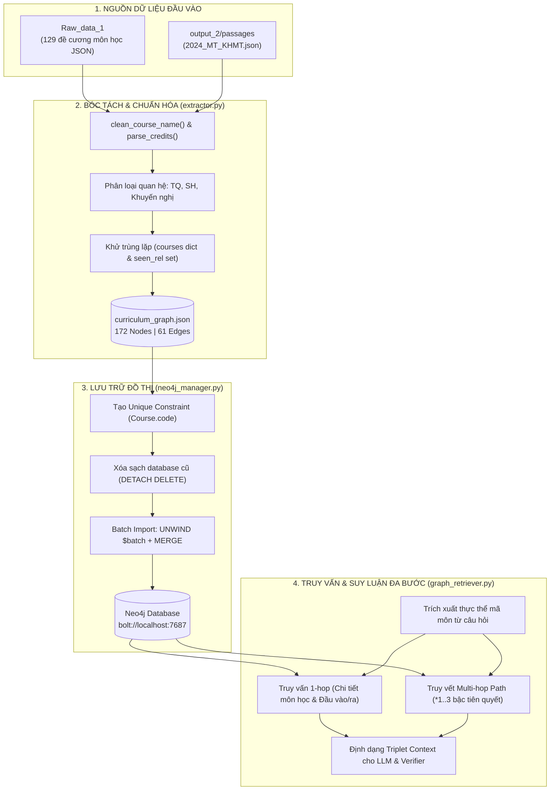

# 📘 Luồng Hoạt Động Chi Tiết của Phân Hệ Knowledge Graph (KG)

> **Đề tài 3:** RAG Neuro-Symbolic kết hợp Knowledge Graph và Suy luận có kiểm chứng  
> **Khoa Khoa học & Kỹ thuật Máy tính - Trường Đại học Bách Khoa, ĐHQG-HCM (HCMUT)**  
> **Tài liệu kỹ thuật:** Chi tiết kiến trúc, dữ liệu, logic xử lý và hướng dẫn vận hành module Knowledge Graph.

---

## 1. 🏗️ Sơ Đồ Kiến Trúc Luồng Dữ Liệu (End-to-End Flow)

Phân hệ Knowledge Graph chịu trách nhiệm xây dựng **Cơ sở tri thức tượng trưng (Symbolic Ground Truth)** từ các đề cương môn học và khung chương trình đào tạo, phục vụ cho việc truy vấn quan hệ logic và đối soát chống ảo giác (Anti-Hallucination).



---

## 2. 🧩 Bản Đồ Schema & Ontology Của Đồ Thị

### 2.1. Node Label: `:Course`
Mỗi nút (Node) đại diện cho một môn học trong chương trình đào tạo với các thuộc tính:
* `code` *(String, Khóa chính duy nhất)*: Mã môn học chuẩn HCMUT (VD: `CO2003`, `MT1003`).
* `name` *(String)*: Tên môn học tiếng Việt đã chuẩn hóa, loại bỏ tiền tố trùng mã.
* `credits` *(Integer)*: Số tín chỉ nguyên tương ứng của môn học.

### 2.2. Relationship Types (Quan hệ giữa các môn học)
* `[:PREREQUISITE_FOR]`: Môn nguồn là **tiên quyết bắt buộc** của môn đích (ký hiệu `TQ` trong đề cương). Sinh viên phải đạt môn nguồn mới được đăng ký môn đích.
* `[:RECOMMENDED_FOR]`: Môn nguồn là **môn học trước / khuyến nghị** của môn đích.
* `[:CO_REQUISITE_FOR]`: Môn nguồn là **môn song hành** với môn đích (ký hiệu `SH`).

### 2.3. Thống kê quy mô đồ thị hiện tại
* **Tổng số Nodes (Môn học):** `172`
* **Tổng số Edges (Mối quan hệ):** `61`
  * `PREREQUISITE_FOR`: `18`
  * `RECOMMENDED_FOR`: `43`
  * `CO_REQUISITE_FOR`: `0`

---

## 3. 🔬 Phân Tích Kỹ Thuật Từng Module Mã Nguồn

### 3.1. Cấu hình tập trung (`src/config/settings.py`)
* Sử dụng thư viện `pathlib.Path` để chuẩn hóa đường dẫn độc lập với hệ điều hành (Windows, Linux, macOS).
* Định nghĩa các biến môi trường kết nối Neo4j: `NEO4J_URI`, `NEO4J_USERNAME`, `NEO4J_PASSWORD` với cơ chế fallback mặc định an toàn.

---

### 3.2. Trích xuất bộ ba tri thức (`src/graph_module/extractor.py`)
* **Xử lý môi trường chạy:**
  * Bổ sung `sys.path.insert(0, str(BASE_DIR))` để tránh lỗi `ModuleNotFoundError: No module named 'src'` khi chạy script độc lập.
  * Thiết lập `sys.stdout.reconfigure(encoding="utf-8")` nhằm khắc phục lỗi bảng mã `cp1252` trên PowerShell Windows khi in ký tự tiếng Việt có dấu.
* **Chiến lược đọc dữ liệu kép (Dual-source Extraction):**
  1. Nguồn 1 (`data/raw/Raw_data_1/`): Bóc tách 129 đề cương chuyên ngành máy tính, lấy thông tin tín chỉ `pbsotc` và mảng phụ thuộc `monhocdieukien`.
  2. Nguồn 2 (`data/processed/output_2/passages/2024_MT_KHMT.json`): Bóc tách các đoạn có `content_type == "course_entity"` để bổ sung đầy đủ các môn đại cương (Toán giải tích, Đại số tuyến tính, Vật lý,...) mà `Raw_data_1` không chứa đề cương riêng.
* **Chuẩn hóa chuỗi:**
  * `clean_course_name()`: Tách phần mã lặp ở đầu tên (`"CO1005 - Nhập môn Điện toán"` $\rightarrow$ `"Nhập môn Điện toán"`).
  * `parse_credits()`: Sử dụng biểu thức chính quy `r"^(\d+)"` chuyển chuỗi phức tạp `"4(3.1.4)"` thành số nguyên `4`.
* **Khử trùng lặp:** Dùng `courses = {}` (Dictionary theo `code`) và `seen_rel = set()` (Set lưu `(source, type, target)`).
* **Kết quả:** Xuất ra file trung gian chuẩn JSON tại `data/graph_triplets/curriculum_graph.json`.

---

### 3.3. Nạp dữ liệu vào cơ sở dữ liệu (`src/graph_module/neo4j_manager.py`)
* **Quản lý kết nối an toàn (Context Manager):** Cung cấp cấu trúc `with Neo4jManager() as manager:` đảm bảo giải phóng socket và đóng driver an toàn dù có ngoại lệ xảy ra.
* **Đảm bảo tính toàn vẹn (Idempotency & Constraints):**
  * Thực thi câu lệnh tạo ràng buộc duy nhất:
    ```cypher
    CREATE CONSTRAINT course_code_unique IF NOT EXISTS
    FOR (c:Course) REQUIRE c.code IS UNIQUE
    ```
  * Index tự động tạo ra giúp tăng tốc độ của các phép tìm kiếm `MATCH` và `MERGE` lên mức $O(1)$.
* **Batch Import tối ưu hiệu năng:**
  * Gom các phần tử thành từng lô (`batch_size = 100`) và thực thi qua cú pháp `UNWIND $batch AS item MERGE ...`.
  * Phân loại riêng từng tập quan hệ theo loại (`PREREQUISITE_FOR`, `RECOMMENDED_FOR`) trước khi chạy `MERGE (src)-[r:...]->(tgt)` để đảm bảo tương thích tuyệt đối với Cypher engine thuần (không phụ thuộc vào APOC extension).
* **Tự động đối chiếu:** Lấy số lượng nodes và phân loại relationships thực tế trong database để kiểm chứng việc nạp thành công 100%.

---

### 3.4. Truy vấn đồ thị & Trích xuất suy luận (`src/graph_module/graph_retriever.py`)
* **Nhận diện thực thể tự động (`extract_course_codes_from_text`):**
  * Dùng Regex `r"\b([A-Z]{2}\d{4})\b"` để tự động trích xuất mã môn học xuất hiện trong câu hỏi tự nhiên của sinh viên (VD: *"Điều kiện học CO2003 là gì?"* $\rightarrow$ `['CO2003']`).
* **Truy vấn cục bộ 1-hop (`get_course_details`):**
  * Lấy thông tin cơ bản môn học, danh sách các môn trực tiếp làm tiên quyết cho môn này, các môn khuyến nghị và các môn học mà môn này làm tiên quyết mở đường.
* **Truy vết chuỗi suy luận đa bước (`get_prerequisite_chain` - Multi-hop Traversal):**
  * Thực thi Cypher quét đường đi tự do từ 1 đến 3 bước:
    ```cypher
    MATCH path = (prereq:Course)-[:PREREQUISITE_FOR*1..3]->(target:Course {code: $code})
    RETURN [node in nodes(path) | {code: node.code, name: node.name}] AS path_nodes,
           [rel in relationships(path) | type(rel)] AS path_relationships,
           length(path) AS depth
    ORDER BY depth ASC
    ```
  * *Lưu ý kỹ thuật:* Tính toán trực tiếp trong mệnh đề `RETURN` thay vì dùng mệnh đề `WITH` trung gian để tránh làm mất scope của biến `path`.
* **Đóng gói ngữ cảnh RAG (`query_graph_for_rag`):**
  * Định dạng toàn bộ tri thức truy vấn thành chuỗi Markdown có cấu trúc chặt chẽ, sẵn sàng nạp vào System Prompt của LLM và cung cấp cho lớp Verifier đối soát logic.

---

## 4. 🚀 Hướng Dẫn Vận Hành (CLI Runbook)

### Bước 1: Khởi động Neo4j
- **Nếu dùng Docker:**
  ```powershell
  # Khởi động container đã tạo
  docker start neo4j-dath

  # Hoặc tạo mới nếu chưa có
  docker run -d --name neo4j-dath -p 7474:7474 -p 7687:7687 -e NEO4J_AUTH=neo4j/password123 neo4j:5-community
  ```
- **Nếu dùng Neo4j Desktop:** Mở ứng dụng, chọn DBMS với password `password123` và nhấn **Start**.

### Bước 2: Chạy trích xuất Triplets từ dữ liệu thô
```powershell
python src/graph_module/extractor.py
```
*(Kết quả sinh ra file `data/graph_triplets/curriculum_graph.json`)*.

### Bước 3: Nạp toàn bộ đồ thị vào Neo4j
```powershell
python src/graph_module/neo4j_manager.py
```

### Bước 4: Kiểm thử truy vấn tự động
```powershell
python src/graph_module/graph_retriever.py
```

### Bước 5: Trực quan hóa trên giao diện Web Browser
Truy cập `http://localhost:7474` (User: `neo4j`, Password: `password123`) và thực thi các câu lệnh Cypher sau:
* **Xem toàn bộ cây môn học tiên quyết:**
  ```cypher
  MATCH (c:Course)-[r:PREREQUISITE_FOR]->(t:Course)
  RETURN c, r, t LIMIT 50;
  ```
* **Tìm tất cả môn tiên quyết dẫn đến môn Cấu trúc Dữ liệu & Giải thuật (`CO2003`):**
  ```cypher
  MATCH path = (prereq:Course)-[:PREREQUISITE_FOR*1..3]->(target:Course {code: "CO2003"})
  RETURN path;
  ```

---

## 5. 💡 Vai Trò Học Thuật Của KG Trong Hệ Thống Neuro-Symbolic RAG

| Thách thức của Vector RAG truyền thống | Cách phân hệ Knowledge Graph giải quyết |
| :--- | :--- |
| **Ảo giác quan hệ (Hallucinated Prerequisites):** LLM dễ tự bịa hoặc nhầm lẫn giữa môn tiên quyết (`TQ`) và môn khuyến nghị. | KG lưu trữ sự thật cứng (Deterministic Facts) được xác thực từ đề cương, loại bỏ hoàn toàn khả năng bịa đặt quan hệ. |
| **Thất bại khi suy luận đa bước (Multi-hop Failure):** Câu hỏi dạng *"Để học được môn A, sinh viên cần học các môn nào từ năm nhất?"* đòi hỏi kết nối qua nhiều tài liệu rời rạc, Vector Search chỉ tìm được cục bộ từng tài liệu đơn lẻ. | Cypher duyệt đường đi (`*1..3`) truy vết xuyên suốt toàn bộ chuỗi phụ thuộc một cách tường minh và tức thời. |
| **Thiếu khả năng giải thích (Black-box):** Người dùng không biết vì sao hệ thống đưa ra lời khuyên. | Hệ thống trích xuất được **Reasoning Path (Proof Path)**: `MT1003 -> CO1007 -> CO2003`, làm bằng chứng hiển thị trực tiếp cho sinh viên. |
